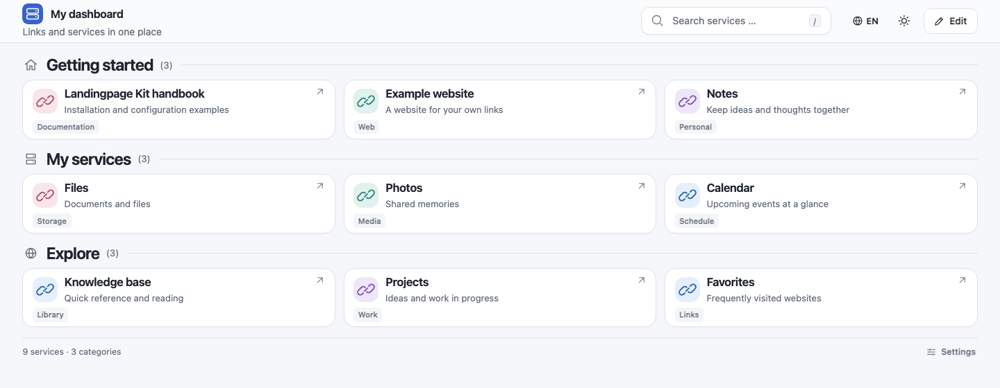

# Landingpage Kit

[Deutsch](README.md) · **English**

Build a dashboard for your services, bookmarks and metrics. Group tiles into categories and edit them in your browser or in a YAML file. The app runs on a computer, server or NAS with Docker Compose. A local Docker volume holds your SQLite database and configuration.

**[Read the handbook](https://r3d42-git.github.io/landingpage-kit/en/)** · **[Download the installation kit](https://github.com/r3d42-git/landingpage-kit/releases/download/v1.1.0/landingpage-kit-1.1.0.zip)** · **[Copy the installation prompt](https://r3d42-git.github.io/landingpage-kit/en/#agent)**



## Get started

Install Docker with the Compose plugin. Unzip the installation kit and open a terminal in the directory containing `compose.yaml`. On Windows, you can run these shell commands in WSL. For a fresh installation:

```sh
cp examples/en/compose.env.example .env
cp examples/en/dashboard.example.yaml dashboard.yaml
docker compose run --rm --no-deps -T landingpage python tools/configure.py init < dashboard.yaml
docker compose run --rm --no-deps landingpage python tools/configure.py password
docker compose up -d --wait
```

Open [your local dashboard](http://127.0.0.1:8080/). Choose **English** in the language selector if needed. The app initially follows your browser language and remembers your selection on this device. The English example file supplies the dashboard title, category names and tile text. The `.env` file selects English for the command-line tools. If you already have a `.env`, set `DASHBOARD_LANGUAGE=en` in that file.

Choose **Edit** to open the HTTPS editor and enter the password you just set. Setup creates a local certificate for this installation. The handbook explains how to check its fingerprint and trust the certificate in your browser. The default ports accept connections only from this computer. [First start and HTTPS](https://r3d42-git.github.io/landingpage-kit/en/#installation)

## What can you put on the dashboard?

| On your dashboard | Guide |
| --- | --- |
| Bookmarks with names, icons and optional availability checks | [Add tiles](https://r3d42-git.github.io/landingpage-kit/en/#kacheln) |
| Service health, Pi-hole statistics, NAS usage or metrics from a local JSON file | [Connect metrics](https://r3d42-git.github.io/landingpage-kit/en/#messwerte) |
| New videos from public YouTube channels | [Set up a YouTube tile](https://r3d42-git.github.io/landingpage-kit/en/#kacheln) |
| A reusable configuration for several installations | [Open the example YAML](examples/en/dashboard.example.yaml) |
| Backups, restores and upgrades | [Operate your instance](https://r3d42-git.github.io/landingpage-kit/en/#betrieb) |

Start with bookmarks and add metrics when you need them. Once the database exists, the YAML tool previews changes before you apply them and checks the revision when saving.

## Container image and source

Compose pulls `ghcr.io/r3d42-git/landingpage-kit:1.1.0` for Linux on AMD64 or ARM64. The [release](https://github.com/r3d42-git/landingpage-kit/releases/tag/v1.1.0) also includes an image archive for each architecture, SHA-256 checksums and the matching source code. Use `docker load` to import an archive for an offline installation.

To start your own repository, choose **Use this template** on GitHub. To build the image from source, run `docker compose -f compose.yaml -f deploy/compose.build.yaml build` and use both files for setup and startup. Store your private configuration, passwords and backups outside public repositories.

## Publish the handbook in your own repository

Open **Settings → Pages** on GitHub. Choose **Deploy from a branch**, select `main` and the `/docs` directory, and save. GitHub displays the published address after deployment. To read the English handbook offline, open `docs/en/index.html` inside the unpacked installation kit.

After editing the example configurations, run `cp examples/*.yaml compose.yaml docs/downloads/` and `cp examples/en/*.yaml docs/downloads/en/`. CI checks that the downloads match the original files. To distribute your own version, update the repository, release and image URLs as well.

## License

Landingpage Kit and its documentation are licensed under the [GNU General Public License, version 3](LICENSE) (`GPL-3.0-only`). The included libraries have their own [third-party notices](THIRD_PARTY_NOTICES.txt).
