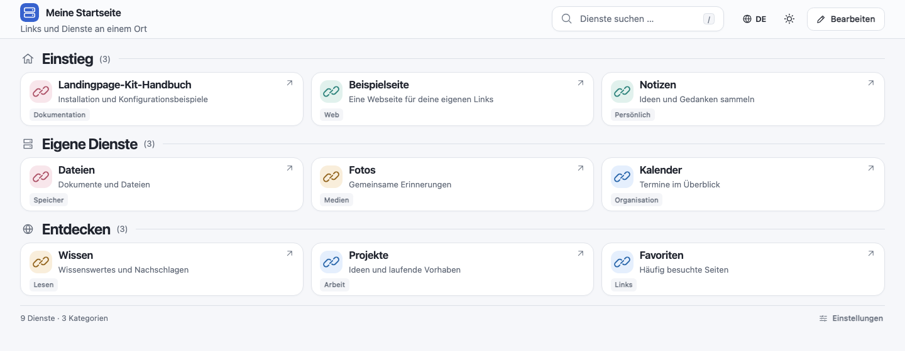

# Landingpage Kit

Baue dir eine Startseite für deine Dienste, Links und Messwerte. Sortiere Kacheln in Kategorien, ändere sie direkt im Browser oder beschreibe das Dashboard in einer YAML-Datei. Die Anwendung läuft auf deinem Rechner, Server oder NAS mit Docker Compose. Inhalte und Einstellungen liegen lokal in SQLite und im Docker-Volume.

**[Zum deutschen Handbuch](https://r3d42-git.github.io/landingpage-kit/)** · **[Installationspaket herunterladen](https://github.com/r3d42-git/landingpage-kit/releases/download/v1.0.0/landingpage-kit-1.0.0.zip)** · **[Installationsprompt kopieren](https://r3d42-git.github.io/landingpage-kit/#agent)**



## Ausprobieren

Du brauchst Docker mit dem Compose-Plugin. Lade das Installationspaket herunter, entpacke es und öffne ein Terminal im Ordner mit der `compose.yaml`. Unter Windows kannst du diese Shell-Befehle in WSL ausführen.

```sh
cp examples/dashboard.example.yaml dashboard.yaml
docker compose run --rm --no-deps -T landingpage python tools/configure.py init < dashboard.yaml
docker compose run --rm --no-deps landingpage python tools/configure.py password
docker compose up -d --wait
```

Öffne [die Startseite auf deinem Rechner](http://127.0.0.1:8080/). Mit **Bearbeiten** wechselst du zum HTTPS-Editor und meldest dich mit dem soeben gewählten Passwort an. Die Ersteinrichtung erzeugt ein eigenes Zertifikat für diese Installation. Im Handbuch steht, wie du das öffentliche CA-Zertifikat prüfst und deinem Browser bekannt machst. Die Standardports sind ausschließlich auf deinem Rechner erreichbar. [Erststart und HTTPS](https://r3d42-git.github.io/landingpage-kit/#installation)

## Was lässt sich damit bauen?

| Auf deiner Startseite | Einstieg |
| --- | --- |
| Linkgruppen mit eigenen Namen, Icons und einer optionalen Erreichbarkeitsprüfung | [Kacheln anlegen](https://r3d42-git.github.io/landingpage-kit/#kacheln) |
| Status eines Dienstes, Pi-hole-Statistiken, NAS-Belegung oder Messwerte aus einer lokalen JSON-Datei | [Messquellen anschließen](https://r3d42-git.github.io/landingpage-kit/#messwerte) |
| Neue Videos mehrerer öffentlicher YouTube-Kanäle | [YouTube-Kachel einrichten](https://r3d42-git.github.io/landingpage-kit/#kacheln) |
| Eine eigene Vorlage für weitere Installationen | [Dashboard-YAML öffnen](examples/dashboard.example.yaml) |
| Sicherungen, Wiederherstellung und Versionswechsel | [Betrieb und Pflege](https://r3d42-git.github.io/landingpage-kit/#betrieb) |

Das Beispiel verwendet neutrale Inhalte. Für den Anfang reichen Links. Du kannst später eine Messquelle definieren und sie über den Editor einer Kachel zuordnen. Für eine bestehende Installation zeigt der YAML-Import vorab die Änderungen und prüft beim Speichern die Revision.

## Image und Quellcode

Compose lädt `ghcr.io/r3d42-git/landingpage-kit:1.0.0`. Das veröffentlichte Image unterstützt Linux auf AMD64 und ARM64. Im [Release](https://github.com/r3d42-git/landingpage-kit/releases/tag/v1.0.0) stehen beide Architekturen auch als Dateien für `docker load` mit SHA-256-Prüfsummen bereit. Der Quellcode für genau diese Version ist über den Tag `v1.0.0` verfügbar.

Mit **Use this template** auf GitHub kannst du ein eigenes Repository anlegen. Um den Container aus den Quellen zu bauen, nutze `docker compose -f compose.yaml -f deploy/compose.build.yaml build` und gib dieselben beiden Dateien bei der Einrichtung und beim Start an. Bewahre eigene Konfiguration, Passwörter und Sicherungen außerhalb öffentlicher Repositories auf.

## Das Handbuch im eigenen Repository veröffentlichen

Öffne in deinem GitHub-Repository **Settings → Pages**. Wähle **Deploy from a branch**, den Branch `main` und den Ordner `/docs`. Speichere die Auswahl. GitHub zeigt dort nach der Veröffentlichung die Adresse deines Handbuchs an. Für den Offlinezugriff kannst du `docs/index.html` direkt aus dem entpackten Installationspaket öffnen.

Wenn du die Beispiele in deiner Vorlage änderst, aktualisiere die Downloadkopien mit `cp examples/*.yaml compose.yaml docs/downloads/`. Der Handbuch-Check vergleicht die Kopien bei jedem betroffenen Pull Request. Für eine eigene öffentliche Distribution passe auch die Repository-, Release- und Registry-Adressen an.

## Lizenz

Die Anwendung und ihre Dokumentation stehen unter der [GNU General Public License, Version 3](LICENSE) (`GPL-3.0-only`). Die mitgelieferten Bibliotheken haben [eigene Lizenzhinweise](THIRD_PARTY_NOTICES.txt).
